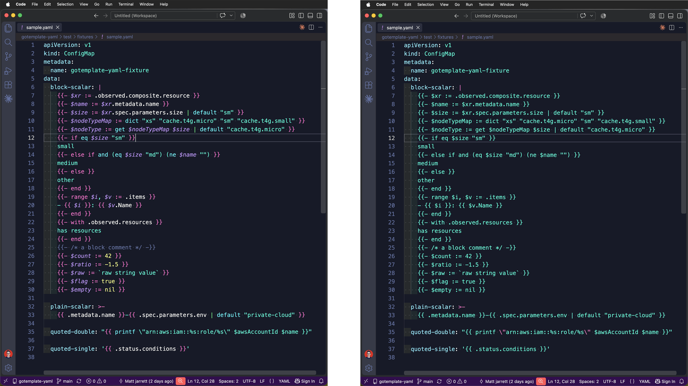

Syntax highlighting and go to definition for Go template expressions inside YAML, including block scalars.

YAML has no idea what `{{ }}` means, so a template in a manifest renders as one flat string and a typo looks exactly like correct code. Built for [Crossplane](https://crossplane.io) compositions using [function-go-templating](https://github.com/crossplane-contrib/function-go-templating); Helm and Argo templates get the same treatment.

## Install

```
code --install-extension cujarrett.gotemplate-yaml
```

Every YAML file is covered with no configuration.

## Highlighting

Colors come from your theme. The YAML inside a `template: |` or `values: |` block is highlighted as YAML, because Crossplane go-templating and ArgoCD Helm values always hold YAML there. Other block scalars stay plain strings.

Highlighting is lexical and does not check that a template is valid.

## Go to definition

Cmd+click (Ctrl+click on Windows and Linux) or F12 inside `{{ }}`.

| Click on | Jumps to |
|---|---|
| `$foo` | Its `:=` in the same template. Several declarations open a list. |
| `$xr.spec.parameters.foo` | The `foo` property in the composition's XRD. Variables are followed back to `.observed.composite.resource`. |
| `index $resources "foo"` | The resource annotated `composition-resource-name: foo` |
| `include "foo"` | Its `define`, in this file or any `.tpl` or YAML file in the workspace |

Runtime-only fields such as `metadata.name` have no definition to jump to.

## Develop

`npm ci`, then `just ci` to lint, test and package. `just run` installs it locally.
